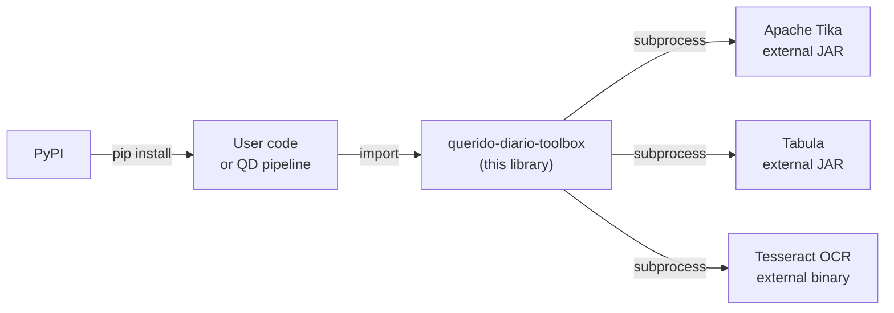

# Architecture

**Python library in the Querido Diário ecosystem for extracting, cleaning, and normalizing text and data from Brazilian official gazettes.**

## Overview

`querido-diario-toolbox` is a Python library published on PyPI that provides utilities for processing official gazettes: text extraction from documents in multiple formats, text cleaning, PDF table extraction, CPF and CNPJ validation, and slug generation for government entities. It exposes no CLI, server, or API — it is consumed via `import` in other projects or Python scripts.

## Context in the OKBR ecosystem

The library is part of the **Querido Diário** project by Open Knowledge Brasil (OKBR), as stated in `README-en-US.md`. The code indicates it can be used both by the main Querido Diário pipeline and by the community for independent analyses of official gazettes.

## Code map

| Path | Responsibility |
| --- | --- |
| `querido_diario_toolbox/gazette.py` | `Gazette` class: facade for text extraction and edition processing |
| `querido_diario_toolbox/page.py` | `Page` class: extends `Gazette` adding PDF table extraction via Tabula |
| `querido_diario_toolbox/etl/` | ETL layer: file type detection, text and metadata extraction |
| `querido_diario_toolbox/etl/file_transform.py` | MIME type detection (python-magic), file reading and writing |
| `querido_diario_toolbox/etl/text_extractor_interface.py` | Abstract interface `TextExtractor` |
| `querido_diario_toolbox/etl/apache_tika_text_extractor.py` | `ApacheTikaExtractor` implementation: invokes the Tika JAR as a subprocess |
| `querido_diario_toolbox/etl/text_extractor.py` | Factory `create_text_extractor()` |
| `querido_diario_toolbox/process/text_process.py` | Text cleaning: `remove_breaks()`, `remove_duplicate_punctuation()`, `execute_tabula()` |
| `querido_diario_toolbox/process/edition_process.py` | CPF and CNPJ extraction and validation with check-digit verification |
| `querido_diario_toolbox/slugs/slugs.py` | Slug generation for government entities: `make_entity_slug()` |
| `tests/` | Unit tests and sample files in multiple formats |
| `examples/` | Jupyter notebooks with usage examples |

## Main flow

### Text extraction and processing

1. The caller instantiates `Gazette(filepath=..., config={...})`, passing the document path and external JAR configuration.
2. `etl/file_transform.py` detects the MIME type via **python-magic** and validates the format.
3. `etl/apache_tika_text_extractor.py` invokes the **Apache Tika** JAR as a subprocess; `.txt` and `.json` files are written to disk.
4. `Gazette.load_content()` loads the extracted text into memory.
5. `process/text_process.py` normalizes the text with `remove_breaks()` and `remove_duplicate_punctuation()`.
6. Optionally, `process/edition_process.py` extracts and validates CPFs and CNPJs found in the text.

### PDF table extraction

1. The caller instantiates `Page(filepath=..., config={...})`.
2. `process/text_process.py` (`execute_tabula()`) invokes the **Tabula** JAR as a subprocess, returning tables as formatted strings.

### Entity slug generation

1. The caller invokes `make_entity_slug(name, state, separator)` in `slugs/slugs.py`.
2. **python-slugify** normalizes the text (removes diacritics and special characters).
3. Returns a slug string ready to use as an entity identifier.

## Stack and external dependencies

| Technology | Role | Evidence |
| --- | --- | --- |
| **Python 3.8+** | Main language | `setup.py` |
| **python-magic** | MIME type detection for input format validation | `requirements.txt`, `etl/file_transform.py` |
| **python-slugify** | Text normalization for slug generation | `requirements.txt`, `slugs/slugs.py` |
| **Apache Tika** (JAR v1.24.1+) | Text and metadata extraction from DOC, DOCX, PDF, HTML, images | `README-en-US.md`, `etl/apache_tika_text_extractor.py` |
| **Tabula** (JAR v1.0.4+) | Table extraction from PDFs | `README-en-US.md`, `process/text_process.py` |
| **Tesseract OCR** | Text recognition in images (PNG, TIFF, JPEG) | `README-en-US.md`, `.github/workflows/test.yml` |
| **Java Runtime** | Running the Tika and Tabula JARs | `Makefile` (target `download-binaries`) |
| **ruff** | Linting and code formatting | `.pre-commit-config.yaml`, `Makefile` |

## Entry points

| Entry point | Use |
| --- | --- |
| `from querido_diario_toolbox import Gazette` | Text extraction from documents (main use case) |
| `from querido_diario_toolbox import Page` | Table extraction from PDFs |
| `from querido_diario_toolbox.process.edition_process import extract_and_validate_cnpj` | CNPJ validation in extracted text |
| `from querido_diario_toolbox.slugs.slugs import make_entity_slug` | Slug generation for a government entity |
| `make setup` | Sets up the development environment (venv, deps, JARs, hooks) |
| `make test` / `make coverage` | Runs the test suite |
| `make publish` | Publishes a new version to PyPI |

## Internal references

| File | Contents |
| --- | --- |
| `README-en-US.md` | Installation, usage, examples, and project overview |
| `CONTRIBUTING-en-US.md` | Contribution guide and development setup |
| `README.md` | Portuguese version of the README |
| `CONTRIBUTING.md` | Portuguese version of the contribution guide |
| `examples/` | Jupyter notebooks with practical usage examples |

## Tests and quality

| Item | Detail |
| --- | --- |
| Test suite | `tests/` with sample files in PDF, DOC, DOCX, ODT, HTML, PNG, TIFF, JPEG |
| Framework | `unittest` (auto-discovery via `make test`) |
| Coverage | Measured via **coverage** (`make coverage`) |
| CI | `.github/workflows/test.yml`: runs `check` + `coverage` on push/PR to `main` |
| Code quality | **ruff** via pre-commit hooks (linting + auto-formatting) |
