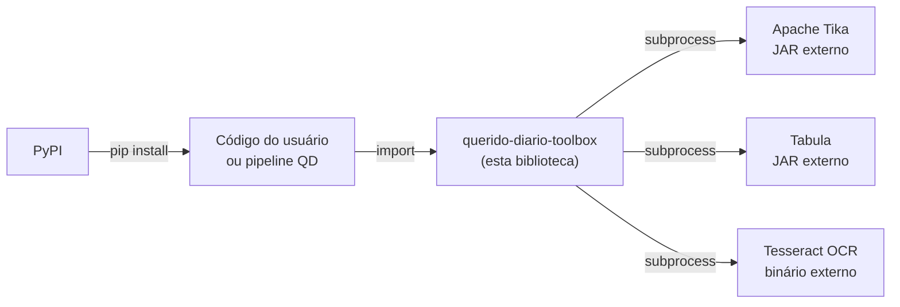

# Arquitetura

**Biblioteca Python do ecossistema Querido Diário para extração, limpeza e normalização de textos e dados de diários oficiais brasileiros.**

## Visão geral

`querido-diario-toolbox` é uma biblioteca Python publicada no PyPI que fornece utilitários para processar diários oficiais: extração de texto de documentos em múltiplos formatos, limpeza textual, extração de tabelas em PDF, validação de CPF e CNPJ, e geração de slugs para entidades governamentais. Não expõe CLI, servidor ou API — é consumida via `import` em outros projetos ou scripts Python.

## Contexto no ecossistema da OKBR

A biblioteca integra o projeto **Querido Diário** da Open Knowledge Brasil (OKBR), conforme `README.md`. O código indica que ela pode ser usada tanto pelo pipeline principal do Querido Diário quanto pela comunidade em análises independentes de diários oficiais.

## Mapa do código

| Caminho | Responsabilidade |
| --- | --- |
| `querido_diario_toolbox/gazette.py` | Classe `Gazette`: facade para extração de texto e processamento de edições |
| `querido_diario_toolbox/page.py` | Classe `Page`: estende `Gazette` adicionando extração de tabelas via Tabula |
| `querido_diario_toolbox/etl/` | Camada ETL: detecção de tipo de arquivo, extração de texto e metadados |
| `querido_diario_toolbox/etl/file_transform.py` | Detecção de MIME type (python-magic), leitura e escrita de arquivos |
| `querido_diario_toolbox/etl/text_extractor_interface.py` | Interface abstrata `TextExtractor` |
| `querido_diario_toolbox/etl/apache_tika_text_extractor.py` | Implementação `ApacheTikaExtractor`: invoca o JAR do Tika como subprocesso |
| `querido_diario_toolbox/etl/text_extractor.py` | Factory `create_text_extractor()` |
| `querido_diario_toolbox/process/text_process.py` | Limpeza textual: `remove_breaks()`, `remove_duplicate_punctuation()`, `execute_tabula()` |
| `querido_diario_toolbox/process/edition_process.py` | Extração e validação de CPF e CNPJ com verificação de dígitos |
| `querido_diario_toolbox/slugs/slugs.py` | Geração de slugs para entidades governamentais: `make_entity_slug()` |
| `tests/` | Testes unitários e arquivos de amostra em múltiplos formatos |
| `examples/` | Jupyter notebooks com exemplos de uso |

## Fluxo principal

### Extração e processamento de texto

1. O chamador instancia `Gazette(filepath=..., config={...})` passando o caminho do documento e a configuração dos JARs externos.
2. `etl/file_transform.py` detecta o MIME type via **python-magic** e valida o formato.
3. `etl/apache_tika_text_extractor.py` invoca o JAR do **Apache Tika** como subprocesso; os arquivos `.txt` e `.json` são gravados em disco.
4. `Gazette.load_content()` carrega o texto extraído para memória.
5. `process/text_process.py` normaliza o texto com `remove_breaks()` e `remove_duplicate_punctuation()`.
6. Opcionalmente, `process/edition_process.py` extrai e valida CPFs e CNPJs presentes no texto.

### Extração de tabelas em PDF

1. O chamador instancia `Page(filepath=..., config={...})`.
2. `process/text_process.py` (`execute_tabula()`) invoca o JAR do **Tabula** como subprocesso, retornando as tabelas como strings formatadas.

### Geração de slug de entidade

1. O chamador invoca `make_entity_slug(name, state, separator)` em `slugs/slugs.py`.
2. **python-slugify** normaliza o texto (remove diacríticos e caracteres especiais).
3. Retorna uma string slug pronta para uso como identificador de entidade.

## Stack e dependências externas

| Tecnologia | Papel | Evidência |
| --- | --- | --- |
| **Python 3.8+** | Linguagem principal | `setup.py` |
| **python-magic** | Detecção de MIME type para validação de formato de entrada | `requirements.txt`, `etl/file_transform.py` |
| **python-slugify** | Normalização de texto para geração de slugs | `requirements.txt`, `slugs/slugs.py` |
| **Apache Tika** (JAR v1.24.1+) | Extração de texto e metadados de DOC, DOCX, PDF, HTML, imagens | `README.md`, `etl/apache_tika_text_extractor.py` |
| **Tabula** (JAR v1.0.4+) | Extração de tabelas de PDFs | `README.md`, `process/text_process.py` |
| **Tesseract OCR** | Reconhecimento de texto em imagens (PNG, TIFF, JPEG) | `README.md`, `.github/workflows/test.yml` |
| **Java Runtime** | Execução dos JARs Tika e Tabula | `Makefile` (target `download-binaries`) |
| **ruff** | Lint e formatação de código | `.pre-commit-config.yaml`, `Makefile` |

## Pontos de entrada

| Entrada | Uso |
| --- | --- |
| `from querido_diario_toolbox import Gazette` | Extração de texto de documentos (principal caso de uso) |
| `from querido_diario_toolbox import Page` | Extração de tabelas em PDFs |
| `from querido_diario_toolbox.process.edition_process import extract_and_validate_cnpj` | Validação de CNPJ em texto extraído |
| `from querido_diario_toolbox.slugs.slugs import make_entity_slug` | Geração de slug para entidade governamental |
| `make setup` | Configura o ambiente de desenvolvimento (venv, deps, JARs, hooks) |
| `make test` / `make coverage` | Executa a suite de testes |
| `make publish` | Publica nova versão no PyPI |

## Referências internas

| Arquivo | Conteúdo |
| --- | --- |
| `README.md` | Instalação, uso, exemplos e visão geral do projeto |
| `CONTRIBUTING.md` | Guia de contribuição e setup de desenvolvimento |
| `README-en-US.md` | Versão em inglês do README |
| `CONTRIBUTING-en-US.md` | Versão em inglês do guia de contribuição |
| `examples/` | Jupyter notebooks com exemplos práticos de uso da biblioteca |

## Testes e qualidade

| Item | Detalhe |
| --- | --- |
| Suite de testes | `tests/` com amostras de arquivo em PDF, DOC, DOCX, ODT, HTML, PNG, TIFF, JPEG |
| Framework | `unittest` (descoberta automática via `make test`) |
| Cobertura | Medida via **coverage** (`make coverage`) |
| CI | `.github/workflows/test.yml`: roda `check` + `coverage` em push/PR para `main` |
| Qualidade de código | **ruff** via pre-commit hooks (lint + formatação automática) |
